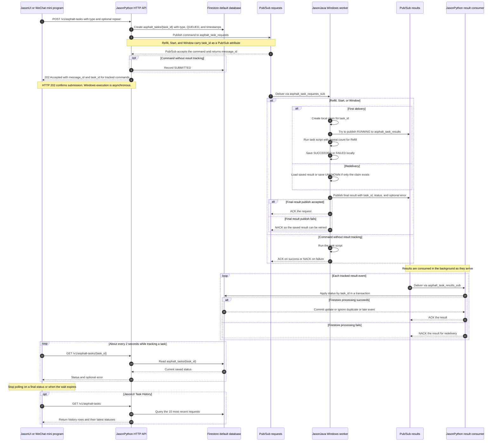

# Asphalt Tasks API

`POST /v1/asphalt-tasks` publishes a one-shot command to the Google
Cloud Pub/Sub topic `asphalt_task_requests`. It uses the same Google credentials
and project as Firestore.

The `type` field accepts `RESET`, `START_GAME`, `CLOSE_GAME`, `WINDOW`, `MUTE`,
and `REFILL_ADS`. A refill also accepts an integer `repeat` from 1 through 99;
when omitted, it defaults to 8:

```bash
curl -X POST http://127.0.0.1:8000/v1/asphalt-tasks \
  -H 'Content-Type: application/json' \
  -d '{"type":"RESET"}'
```

```bash
curl -X POST http://127.0.0.1:8000/v1/asphalt-tasks \
  -H 'Content-Type: application/json' \
  -d '{"type":"REFILL_ADS","repeat":8}'
```

The API returns `202 Accepted` after Pub/Sub acknowledges the publish:

```json
{
  "type": "RESET",
  "topic": "projects/jasonapp-xm0830/topics/asphalt_task_requests",
  "message_id": "1234567890"
}
```

Each API request publishes exactly one Pub/Sub message. Reset uses:

```json
{"type":"RESET"}
```

Refill includes its repeat count in that single message:

```json
{"type":"REFILL_ADS","repeat":8}
```

Refill, Start, and Window responses include a `task_id` in addition to the Pub/Sub `message_id`.
Query `GET /v1/asphalt-tasks/{task_id}` for the task's `type` and status.
Status can be `QUEUED`, `RUNNING`,
`SUCCEEDED`, `FAILED`, or `UNKNOWN`. A successful result means the Windows
script completed its requested runs. Failed or unknown results can include an
`error` message.

The Windows worker publishes updates to `asphalt_task_results`. JasonPython
consumes `asphalt_task_results_sub` in both startup modes and saves the status
in Firestore. The backend account needs subscriber access on that subscription
and write access to the Firestore collection `asphalt_tasks`. Each document
stores the task `type`, e.g. `REFILL_ADS`.

`GET /v1/asphalt-tasks` returns the last 10 requests in newest-first order.
Each entry includes the task type, request time, and status. Untracked
commands show `SUBMITTED` after Pub/Sub accepts them. Tracked status updates
continue to come from the worker.

Start game uses:

```json
{"type":"START_GAME"}
```

Close game uses:

```json
{"type":"CLOSE_GAME"}
```

Window uses:

```json
{"type":"WINDOW"}
```

Mute uses:

```json
{"type":"MUTE"}
```

An unsupported type returns `422`. Missing Google credentials or a Pub/Sub
publish failure returns `503`.

## Credentials and permission

Local startup reads `~/.config/jasonapp/service-account.json` through
`GOOGLE_APPLICATION_CREDENTIALS`. Grant that file's `client_email` the
`Pub/Sub Publisher` (`roles/pubsub.publisher`) role on
`asphalt_task_requests`. Scope its subscriber access to the result subscription.

The Windows worker uses a separate service account with
`roles/pubsub.subscriber` on `asphalt_task_requests_sub` and
`roles/pubsub.publisher` on `asphalt_task_results`.

## Task request and result flow



Firestore is the source of truth for the displayed status. The UI only talks
to JasonPython over HTTP. For commands without result tracking, `SUBMITTED`
means Pub/Sub accepted the request. For tracked commands, a worker result comes from
the worker. If only a local claim survives a worker crash, the worker reports
`UNKNOWN` on redelivery because the script may have run partially.
